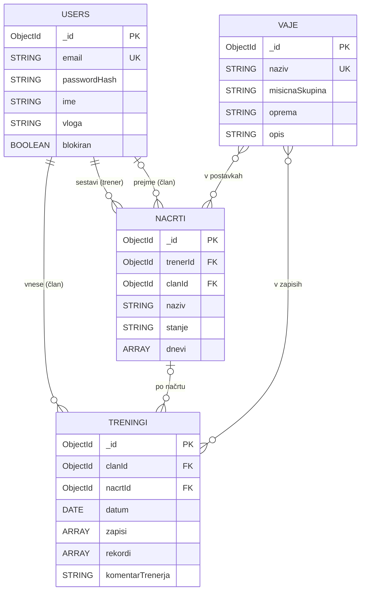

# 03 – Podatkovni model

Baza: MongoDB (dokumentna). Podatki so razdeljeni v štiri zbirke, povezave so reference (shranimo `_id` povezanega dokumenta).

**Glavne entitete:**
- users: uporabniki in njihove vloge (član, trener, skrbnik).
- vaje: knjižnica vaj z mišično skupino in opremo.
- nacrti: načrti vadbe, ki jih trener sestavi in dodeli članu; vsebujejo vgnezdene dneve in vaje s serijami in ponovitvami.
- treningi: opravljeni treningi članov; vsebujejo vgnezdene serije (teža, ponovitve), samodejno zaznane rekorde in komentar trenerja.

## Vizualizacija:

## Opombe
- `vloga` ima vrednosti `clan`, `trener`, `admin`; `stanje` načrta je `osnutek`, `dodeljen`, `aktiven` ali `zakljucen`.
- `clanId` v načrtu se nastavi šele ob dodelitvi, `nacrtId` v treningu je neobvezen (član lahko vnese tudi prost trening).
- Vgnezdene tabele: `dnevi` = `{ naziv, postavke: [{ vajaId, serije, ponovitve }] }`, `zapisi` = `{ vajaId, serije: [{ teza, ponovitve }] }`, `rekordi` = `{ vajaId, teza }`. Teža je v kg.
- Dnevi in serije so vgnezdeni, ker se vedno berejo skupaj z načrtom oz. treningom; uporabniki, vaje in načrti so samostojne zbirke z referencami.