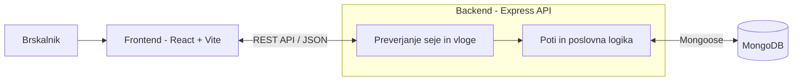

# 04 – Arhitektura in tehnološki sklad

## Arhitektura

### Glavni deli sistema
1. Brskalnik: odjemalec, v katerem uporabnik odpre aplikacijo GymLog.
2. Frontend (React + Vite): enostranska aplikacija, ki prikazuje knjižnico vaj, načrte, obrazce za vnos treninga in zgodovino. Podatke dobi od backenda.
3. Backend (Node.js + Express): REST API, ki sprejema zahteve, preverja sejo in vlogo ter izvaja poslovno logiko (stanja načrta, zaznava osebnih rekordov).
4. Podatkovna baza (MongoDB): hrani zbirke `users`, `vaje`, `nacrti`, `treningi` ter seje prijavljenih uporabnikov.

### Komunikacija med deli
Frontend kliče backend prek REST API (na primer `GET /api/nacrti`, `POST /api/treningi`), podatki se prenašajo v formatu JSON. Backend po potrebi prebere ali zapiše podatke v MongoDB prek knjižnice Mongoose in vrne JSON odgovor s statusno kodo. Med razvojem Vite posreduje zahteve na `/api` na backend, zato brskalnik vidi en sam naslov in dodatna nastavitev CORS ni potrebna.

### Diagram

### Podatkovna baza
MongoDB hrani štiri povezane zbirke (podrobno v dokumentu 03). Dnevi načrta in serije treninga so vgnezdeni v nadrejeni dokument, ostale povezave so reference na `_id`. Za pregled zbirk in poizvedb se uporablja MongoDB Compass.

### Avtentikacija in upravljanje uporabnikov
- Registracija in prijava z e-poštnim naslovom in geslom.
- Geslo je shranjeno kot zgostitev (bcryptjs), nikoli kot navaden tekst.
- Po prijavi backend ustvari sejo v piškotku `httpOnly`; podatki seje so v MongoDB (`connect-mongo`). Frontend piškotek pošilja samodejno z vsako zahtevo.
- Vmesna funkcija na backendu pri vsaki zahtevi preveri vlogo (`clan`, `trener`, `admin`) in lastništvo vira: član vidi samo svoje treninge, trener samo treninge članov, ki imajo od njega načrt.
- Frontend skrije strani, ki jih vloga ne sme videti, vendar je to le udobje; prava zaščita je na backendu.
- Nov uporabnik je privzeto član, vloge dodeljuje skrbnik; blokiran uporabnik se ne more prijaviti.

### Lokalni zagon (macOS)
Za lokalni razvoj bo uporabljena MongoDB, nameščena prek Homebrew, in Node.js. Projekt ima dve mapi, `backend` in `frontend`. Nastavitve povezave z bazo in skrivnost za seje bodo shranjene v datoteki .env v mapi backend, začetni podatki pa se naložijo s skripto seed.
1. Namestitev baze: `brew tap mongodb/brew` in `brew install mongodb-community`
2. Zagon baze: `brew services start mongodb-community`
3. Backend, priprava: v mapi `backend` zaženite `npm install` in `cp .env.example .env`
4. Backend, začetni podatki: `npm run seed`
5. Backend, zagon: `npm start` (API teče na `http://localhost:3000`)
6. Frontend: v drugem terminalu v mapi `frontend` zaženite `npm install` in `npm run dev`, nato odprite `http://localhost:5173`

## Tehnološki sklad

- Frontend: React, Vite, React Router, HTML, CSS
- Backend: Node.js, Express (REST API, JSON)
- Podatkovna baza: MongoDB, Mongoose (modeli in validacija)
- Avtentikacija: express-session, connect-mongo, bcryptjs
- Lokalni razvoj: macOS, Homebrew, npm, nodemon, dotenv
- Drugi deli: skripta `seed` za začetne podatke, MongoDB Compass in Postman za pregled podatkov in testiranje API-ja

## Arhitekturne odločitve
1. Ločen frontend in REST API: jasna delitev med prikazom in logiko; isti API lahko kasneje uporabi tudi mobilna aplikacija ali grafi napredka.
2. React z Vite: najbolj razširjeno ogrodje z veliko gradiva; stanje komponent olajša obrazca z ponavljajočimi se vrsticami (sestavljanje načrta, vnos serij).
3. Vite z vmesnim strežnikom (proxy): hiter razvoj in brez težav s CORS, ker brskalnik komunicira z enim naslovom.
4. MongoDB z Mongoose: dokumenti se naravno prilegajo podatkom (načrt z dnevi, trening s serijami), Mongoose doda sheme in validacijo.
5. Vgnezdeni dnevi in serije: vedno se berejo skupaj z nadrejenim dokumentom, zato je dovolj ena poizvedba.
6. Rekordi se izračunajo ob shranjevanju treninga: pregled zgodovine ne zahteva ponovnega računanja.
7. Seje s piškotki namesto JWT: enostavnejše za aplikacijo z eno domeno in piškotek `httpOnly` ni dostopen skriptam v brskalniku.
8. Preverjanje pravic na backendu: skrivanje strani v frontendu ni dovolj za varnost.
9. bcryptjs namesto bcrypt: čista JavaScript knjižnica brez prevajanja, deluje brez težav na macOS, tudi na Apple Silicon.
10. Lokalna MongoDB prek Homebrew: preprosta namestitev na MacBooku; oblačni MongoDB Atlas je rezerva, če namestitev ne uspe (zamenja se samo `MONGODB_URI`).