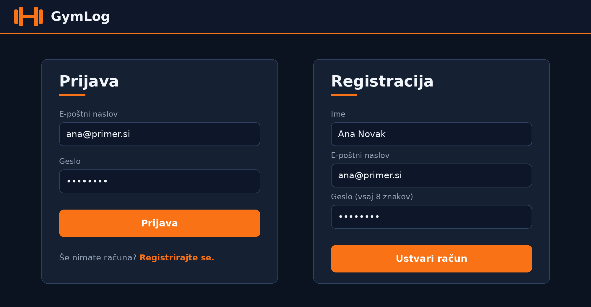
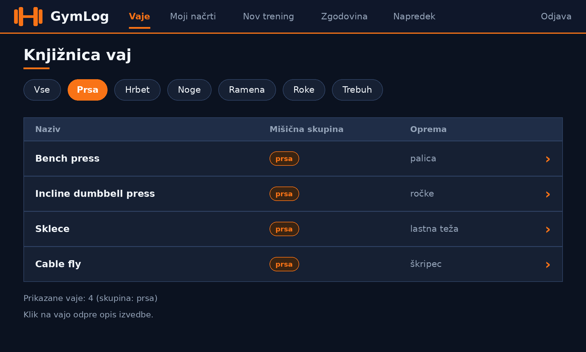
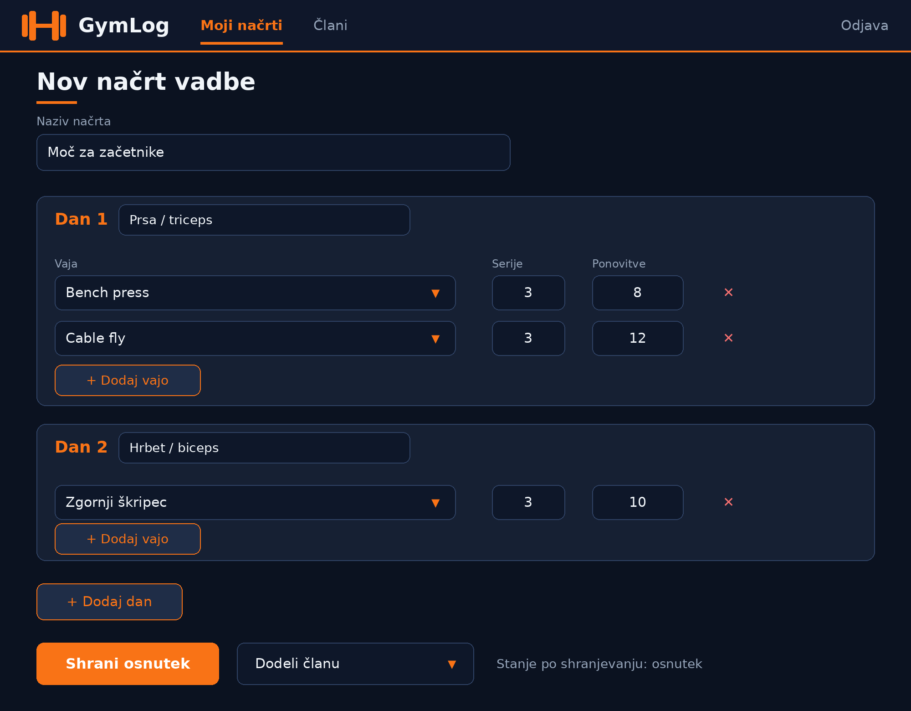
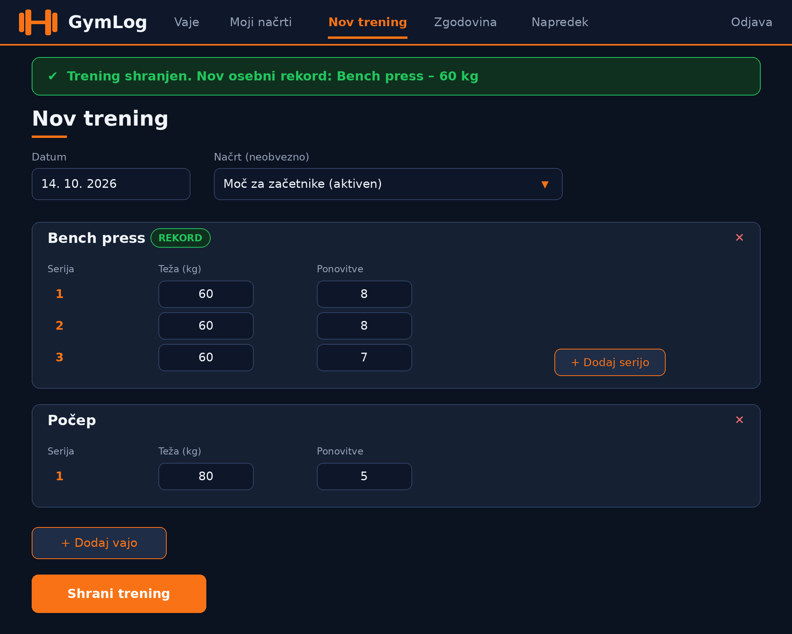
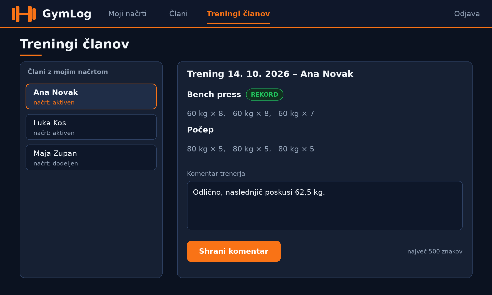
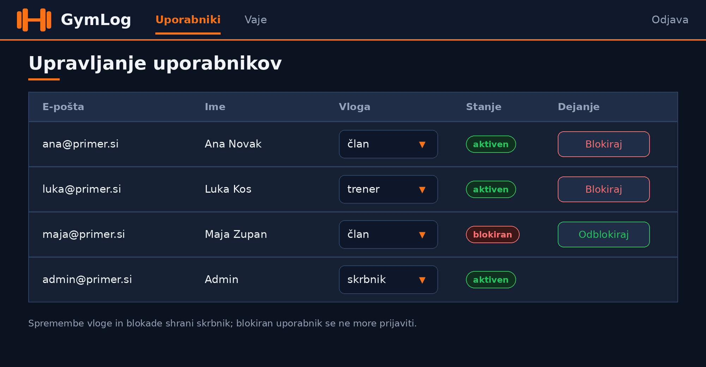

# 06 – Wireframes

Wireframes prikazujejo osnovni izgled najpomembnejših zaslonov aplikacije GymLog. Narisani so kot preproste skice v temnem videzu z oranžnim poudarkom, da je v ospredju razporeditev elementov. Vsak zaslon je povezan z uporabniškimi zgodbami iz dokumenta 05.

## Wireframe 1: Prijava in registracija

Povezava do slike: [WF-01-prijava-registracija.png](images/01-prijava-registracija.png)

Zaslon ima dva obrazca: prijavo z e-poštnim naslovom in geslom ter registracijo z imenom, e-poštnim naslovom in geslom (vsaj 8 znakov). Novi uporabnik po registraciji postane član. Povezane zgodbe: US-01, US-02.

## Wireframe 2: Knjižnica vaj (član)

Povezava do slike: [WF-02-knjiznica-vaj.png](images/02-knjiznica-vaj.png)

Zgoraj je meni člana (Vaje, Moji načrti, Nov trening, Zgodovina, Napredek). Pod naslovom so gumbi za filtriranje po mišični skupini, izbrana je skupina Prsa. Seznam prikazuje naziv, mišično skupino in opremo vsake vaje, klik na vrstico odpre opis. Povezana zgodba: US-03.

## Wireframe 3: Sestavljanje načrta vadbe (trener)

Povezava do slike: [WF-03-sestavljanje-nacrta.png](images/03-sestavljanje-nacrta.png)

Trener vnese naziv načrta, nato doda dneve. Vsak dan ima naziv in vrstice z vajo (izbira iz knjižnice), številom serij in ponovitev ter gumbom za odstranitev. Gumbi omogočajo dodajanje vaj in dni, shranjevanje osnutka in dodelitev načrta članu. Povezane zgodbe: US-04, US-05, US-13.

## Wireframe 4: Vnos treninga (član)

Povezava do slike: [WF-04-vnos-treninga.png](images/04-vnos-treninga.png)

Član izbere datum in po želji svoj aktivni načrt, nato doda vaje in za vsako serije s težo in ponovitvami. Po shranjevanju se zgoraj prikaže zeleno sporočilo z novim osebnim rekordom, vaja z rekordom pa dobi oznako REKORD. Povezane zgodbe: US-07, US-08.

## Wireframe 5: Pregled treninga člana (trener)

Povezava do slike: [WF-05-pregled-treninga-trener.png](images/05-pregled-treninga-trener.png)

Levo je seznam članov, ki imajo načrt tega trenerja, desno pa podrobnosti izbranega treninga z vajami, serijami in oznako rekorda. Spodaj je polje za komentar (do 500 znakov) z gumbom za shranjevanje. Povezana zgodba: US-11.

## Wireframe 6: Upravljanje uporabnikov (skrbnik)

Povezava do slike: [WF-06-upravljanje-uporabnikov.png](images/06-upravljanje-uporabnikov.png)

Tabela prikazuje e-pošto, ime, vlogo (spustni seznam), stanje in dejanje za vsakega uporabnika. Skrbnik lahko spremeni vlogo ter uporabnika blokira ali odblokira. Povezana zgodba: US-14.

## Opomba
Ostali zasloni (zgodovina treningov, napredek po vaji, sprejem in zaključek načrta, upravljanje vaj) uporabljajo enak meni in enako razporeditev kot zgoraj prikazani zasloni, zato niso posebej narisani.
